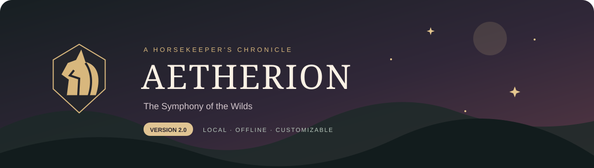

<div align="center">



**Version 1.3.0 · Definition Managers & Horse Profile Redesign**

**A local fantasy horse sanctuary you can make your own.**

Explore woodland realms, collect companions, and customize your world through visual editors.

[Get Started](#get-started) · [Features](#features) · [Customization](#make-it-yours) · [Backups](#backups) · [Roadmap](#remaining-features)

</div>

---

> **Version 1.3 improves definition management and horse profiles, building on version 1.2’s data-driven spawning and local configuration.** Cosmic/Wild selection, weighted species, cascading mutations, sizes, gender, aesthetics, personalities, horse import/export, and local saves work today. Full horse creation, gameplay effects, breeding, inventory gameplay, and Town activities remain planned.

## Version History

Versions follow **major.minor.patch**: major for breaking changes, minor for compatible features, patch for fixes. Commits are grouped by release rather than each receiving a new version.

| Version | Changes |
| --- | --- |
| **1.3.0 — current** | Adds searchable eye color cards, rarity groups and percentage display controls, modal CRUD, random color creation, personality cards/emojis and modal editing, separate Traits navigation, and grouped horse traits with four mutation slots. |
| **1.2.0** | Adds five file-backed Horse Definitions managers, tier/zone weight synchronization, Cosmic/Wild spawning, nineteen mutation token weights, duplicate lockout, thresholds, size generation, and recoverable configuration saves. |
| **1.1.0** | Adds catch-time naming, per-horse notes and editable details, text deletion/restoration, independent equal-odds species spawning, and profile/navigation refinements. Includes gameplay/UI commits through `6aec655`. |
| **1.0.0 — initial preview** | Local collection and saves, editable definitions and zones, themes, website text editing, profiles, search, and backups. Baseline commit: `4b18fa7`. |

Existing player saves migrate automatically with a dated backup. Breeding and executable gameplay effects remain planned. The current automated suite has **88 passing tests**; browser visual QA remains pending.

## Get Started

### 1. Install the prerequisites

| You need | How to get it |
| --- | --- |
| **Node.js 22 or newer, with npm** | Download an **LTS** installer for your operating system from [nodejs.org](https://nodejs.org/en/download). On Windows, run the `.msi` installer with its default Node.js/npm components, then reopen your terminal. |
| **A modern browser** | Use an up-to-date Edge, Chrome, Firefox, or Safari. Windows includes Edge. |
| **Project files** | Download the ZIP below, or clone with Git. |
| **Git — optional** | Only needed for cloning and Git-based updates. Install from [git-scm.com](https://git-scm.com/install/windows) on Windows, or choose your platform on that site. ZIP users do not need Git. |

Check the installation in PowerShell, Command Prompt, or your terminal:

```text
node --version
npm --version
```

Node must report `v22` or higher. No Python, database, API key, paid account, or build tool is required.

### 2. Get the project

**Easy option:** On this GitHub repository, choose **Code → Download ZIP**, then extract the archive into a writable folder. [GitHub's download guide](https://docs.github.com/en/repositories/working-with-files/using-files/downloading-source-code-archives) shows the steps.

**Git option:**

```sh
git clone https://github.com/zanderlx/HorseGenerator.git
cd HorseGenerator
```

### 3. Start your sanctuary

Open a terminal **inside the extracted or cloned folder containing `package.json`**:

```sh
npm start
```

Open **[http://127.0.0.1:4173](http://127.0.0.1:4173)** in your browser.

**No `npm install` is needed:** version 1 uses Node's built-in modules and has no package dependencies. After downloading Node and the project, the game runs offline.

Keep the terminal open while playing. Press **Ctrl+C** to stop the server. Start it again with `npm start`; your saved world is retained.

<details>
<summary><strong>Troubleshooting & alternate ports</strong></summary>

- **“node” or “npm” is not recognized:** reopen the terminal after installing Node. If necessary, rerun the installer and ensure Node is added to PATH.
- **PowerShell blocks `npm.ps1`:** use `npm.cmd start`, or run `node server.js`. No execution-policy change is necessary.
- **“package.json not found”:** navigate into the project folder, not its parent or the unopened ZIP archive.
- **Port 4173 is in use:** stop the existing server, or choose another port.

PowerShell:

```powershell
$env:PORT = "4174"
npm start
```

macOS/Linux:

```sh
PORT=4174 npm start
```

Then open `http://127.0.0.1:4174`. The server listens only on your computer's loopback address.

- **The browser cannot connect:** confirm the terminal says “Aetherion is ready,” and use its URL. Opening `public/index.html` directly will not run the game.
- **The save cannot be read:** preserve the existing `data` folder before investigating. The app stops rather than silently replacing your progress.

</details>

## Features

| 🌿 Explore & collect | ✨ Build & customize |
| --- | --- |
| Wilds encounters with inspectable horse profiles | Create, edit, randomize, and delete zones with editable tags |
| Catch, rename, favorite, sell, import, and export horses | Define species, traits, palettes, eyes, and personalities |
| Stable search, sorting, favorites, and preserved sale records | Maintain mutation, item, item-theme, and atmosphere definitions |
| Nine-region color swatches and saved characteristics | Edit website wording without changing source code |
| Current gold editor and transaction history | Nine website themes, plus custom theme editing |
| Site-wide search with **Ctrl+K / Cmd+K** | Profile name, About Me, and twelve avatar color choices |
| Automatic JSON saving, exports, and backups | Grouped, alphabetized navigation that retains its scroll position |

Save and Cancel controls appear when a form has changes. Deletion requires confirmation. Existing horse snapshots are preserved when definitions change.


### Definition manager and profile improvements in 1.3

- **Eye Colors:** responsive clickable cards with names, hex values, swatches, search, rarity filters, and alphabetical or rarity sorting. Rarity groups are the default. Headers show the reference Common **60%**, Uncommon **35%**, and Rare **5%**; optional card percentages divide those totals equally among registered colors. These are reference display values: the current spawning pipeline still selects eye records uniformly.
- **Eye editing:** create/edit modals with sticky headers, Name/Rarity fields, trash-icon deletion with confirmation, and unsaved-change prompts. New entries start as **Custom Color**, Common, with one random color. Randomize generates **1–3** colors while preserving text and rarity. Add-color tiles offer white or random additions; Remove Color is hidden for a single swatch. Saved visual layers remain metadata and are not rendered.
- **Personalities:** equal-size readable cards, default personality emojis, italic descriptions, compact labeled search, and pencil editing. Create and edit use modals with emoji choices, a compact emoji/name row, edit-only deletion, and Save after changes. Newly saved entries append to the grid.
- **Horse profiles:** essentials for Eye Color, Mane, and Tail; six optional trait groups with counts and tags for up to thirteen optional traits. Missing-data text remains unboxed. Four equal-size mutation slots show numbered name/description entries or centered locks, plus an assigned count out of four. Horse colors use a 3×3 grid of noninteractive square swatches with bold type labels and hex codes. Catch is wider and centered.
- **Navigation and collection:** consistent Wilds colors, simplified definition headers, and clearer empty-stable wording.

### Mutated Horse palettes

Available under **Horse Definitions → Palettes**:

| Solar | Lunar | Astral | Heavenly | Void |
| --- | --- | --- | --- | --- |
| Gold, orange & red | Icy blues | Lavender & violet | White in all nine regions | Black in all nine regions |

Every supplied hex value is preserved. These are palette definitions; choosing one does **not** activate a special-spawn probability or mutation effect.

### Data-driven spawning

Horse Definitions has separate **Species**, **Traits**, **Palettes**, **Eye Colors**, **Mutations**, and **Personalities** pages. CRUD saves local JSON configuration files. Species expose rarity tiers and zone assignments; Traits edits species-linked appearance options separately. Palette scopes and skin metadata remain available. File paths appear in the top breadcrumb. Internal eye/personality identifiers and unused visual/behavior metadata stay hidden from their forms.

Each search runs the **0.325% Cosmic / 99.675% Wild** split. Cosmic selects any registered species uniformly. Wild selects by zone ticket weights, initially **40 / 100 / 250 / 500** for rarity tiers 1–4. Chained mutation slots stop on failure; the nineteen standard mutations start with **10,101 tokens**. Gender is 50/50, size follows the eleven-step weighted ladder with mutation shifts, and colors/eyes/personality are selected from the current files. Repeated species are allowed.

See [Spawning & Configuration](docs/SPAWNING.md) for exact probabilities, file paths, thresholds, assets, migration, and recovery. Existing horses retain their snapshots; new searches use saved configuration changes.

Only Ghoulsteed has a complete supplied species-specific trait list. Other species use explicit missing-data labels until you add their traits. The illustrations are replaceable SVG artwork, not exact renders of every species, trait, or mutation.

Starting gold and stable limits are provisional settings. **Current Gold** changes your balance; the Economy section within Game Settings includes a sale history table (newest first). The header gold display is informational. The internal Starting Gold value is reserved for future new-game/reset functionality and is hidden from settings. Mutation selection, thresholds, and size shifts are active. Speed, stamina, fertility, item effects, and exact asset rendering remain separate gameplay work.

### Horse view and preview refinements

Edit Mode covers horse-profile headings, labels, and descriptive wording. The Wilds encounter heading and count sentence have been removed. Profile copy is shared across horses and can use `{horseName}`, `{species}`, `{gender}`, `{birthday}`, `{personality}`, `{personalityDescription}`, and `{specialSpawn}`. Editing these templates does not change the underlying horse record. Delete Text saves an empty override; Use Original Wording restores it. Deleted text stays reachable through its pencil while edit mode is enabled.

Cards show all nine color swatches without palette names. Redundant acquaintance/ownership labels, the profile Return button, and the Wilds notes/sanctuary cards are removed. Eye Color appears in the primary Traits row; Horse ID is tracked internally. Interface font sizes increased by two pixels.

In horse profiles, Birthday is the date the horse entered your stable (MM-DD-YYYY), and Age counts calendar days since that date. Existing horses use their saved catch timestamp; newly imported horses start at 0 days. Uncaught horses show Not caught yet. Editing Birthday updates the acquisition date used by Age. The life-stage value (Adult/Foal/Elder) remains internal for compatibility.

### Horse names, notes, and details

Catch a horse to review its prefilled name, optionally change it, and select Save to add it to My Horses. The default name is grey until changed; the catch dialog has Save and Cancel, with no X or separate keep-name button. Click an owned horse’s name to rename it inline; clicking outside or pressing Esc saves it. Owned profiles show a personality description above Notes. Descriptions default to the captured personality. Description and Notes display as text; click either to edit that horse, then save or cancel changes. Notes use a fixed-size box with overflow scrolling and Save/Cancel controls after changes. Wild profiles have Catch without Sell or notes.

Enable Edit Mode to change an individual horse's birthday, origin, size, personality, or eye color. Choices are alphabetized; Origin offers Wild plus origins already in saved horses. Birthdays display as MM-DD-YYYY. These controls save actual horse values, separately from shared page wording.

Stables contains My Horses and Breeding. Use the heart on a horse card to favorite it; choose Favorites in Sort by to show only favorite horses, with an empty-state message when there are none. Owned profiles offer Export Horse instead of Release Horse. Wilds is a single sidebar link to Aetherion Wilds; switch locations using the alphabetized tabs at the top. The separate Breeding navigation and history page are removed; breeding gameplay remains planned. Existing sale records are preserved.

## Make It Yours

| Navigation section | Contents |
| --- | --- |
| **Stables** | My Horses, Breeding; Favorites available in the sort menu |
| **Developer Settings** | Edit Mode, Game Settings (including Economy), Save Management, Remaining Features |
| **Horse Definitions** | Species, Traits, Palettes, Eye Colors, Mutations, and Personalities with local files |
| **World & Items** | Zones, Zone Atmospheres, Items & Potions, Item Themes |
| **Website & Profile** | Appearance & Themes, My Profile |

**My Zones:** existing zone cards appear above the editor. Use the trash icon to request deletion. The editor includes an Event checkbox and a checkbox to show the zone in Wilds navigation; Short Tagline is no longer a field.

**Zone tags:** zone creation and editing include a Tags field (one per line). New drafts include The evergreen realm and Free exploration. Add, replace, or remove tags, including all tags; they display without icons on Wilds pages and in the live preview. Existing zones keep their previous tag defaults.

**Website themes:** Aetherion Original, Rosewater, Lavender Cloud, Mint Meadow, Bluebell Morning, Peach Blossom, Lemon Chiffon, Sea Glass, and Silver Mist. The original remains the default. Other presets offer dark and light variants, with dark selected by default. The Aetherion crest follows your theme colors.

**Edit Mode:** enable it from its dedicated page, visit a section, and use the pencils. Save one section immediately, or preview multiple changes and choose **Save Page**. Discard drafts or restore default wording. Text supports live values such as `{gold}`, `{horseCount}`, and `{sellingPrice}`.

**My Profile:** click the avatar at the top right. Choose a named horse-crest color, enter a display name and About Me text, then save. Avatar selection is deterministic; there is no random avatar generator.

### Horse import and export

Choose **Import Horse** at the top right of My Horses to load a horse JSON file. Open an owned horse and choose **Export Horse** at the bottom right to download the same format. Exporting keeps the horse in your stable. Imports create new IDs, preserve supported horse details, respect stable capacity, and leave existing horses intact.

See the [version 1 format specification](docs/HORSE-FORMAT.md) and [complete importable example](docs/horse-format.example.json). These individual horse files are separate from full save backups. Importing species, colors, and traits does not change your shared definition library.

## Backups

Your primary save lives on disk, **not in browser localStorage**.

| Location | Contents |
| --- | --- |
| `data/player/save.json` | Horses, gold, settings, profile, custom definitions/zones, and website wording |
| `data/backups/previous-save.json` | The save immediately preceding the latest successful change |
| `data/backups/save-*.json` | Dated backups made from Save Management |
| `data/config/` | Authoritative local species/palette/eye/mutation/personality/spawn and zone files |
| `data/backups/pre-spawning-*.json` | Player save preserved before the first configuration migration |
| `data/definitions/catalog.json` | Bootstrap definitions used when config files are first created |
| `docs/references/` | Original reference documents, preserved as supplied |

Copy the entire **`data` folder** before updating the project or making major changes. Save Management also offers **Export All Data** and **Create Backup**. Saves use serialized writes, a temporary file, and atomic replacement.

An exported bundle includes state, definitions, and defaults. It is **not** interchangeable with `save.json`. Automated import and restore are planned. For manual player restoration, stop the server, keep a copy of the current data, replace `data/player/save.json` with a standalone player backup, then restart. To restore world definitions too, restore the matching `data/config/` folder; player backups alone do not replace those files.

Deleting a zone removes its wild encounters, but preserves collected horses. Deleting a horse gives no gold and does not reverse earlier sales. Definition deletion updates future-use references and closes zones left with empty pools. The original website theme and the last required generator entries remain protected.

## Remaining Features

The same roadmap is available in **Developer Settings → Remaining Features**.

| Remaining feature | Information or decisions needed |
| --- | --- |
| **Horse Editor & custom creator** | Birthday, age, origin, size, personality, and eye edits already work. Remaining: species/palette/trait/mutation editing, sandbox validation, custom creation, duplicate handling, and advanced import options. |
| **Generator refinements** | The specified pipeline is implemented. Remaining: exact species artwork, additional species-specific appearance traits, and any future gameplay rules beyond generation. |
| **Mutation effects & exact artwork** | Selection, duplicate control, thresholds, Cosmic slots, and size shifts work. Define speed/stamina/fertility effects, visual stacking, wings, and supply matching artwork/assets. |
| **Breeding & family history** | Parent eligibility, costs, timing, regional color mixing, trait/mutation inheritance, special-spawn inheritance, twins, and lineage restrictions. Cross-species 50/50 species inheritance is already confirmed. |
| **Inventory, gacha & shop** | Final tack/potion lists, equip slots, effects, consumption, duplicates, and prices. The 50-gold gacha price and main reward splits are already supplied. |
| **Town activities & events** | Costs, rewards, progression, and success rules for Spirit Tame, Plush Machine, Ancient Cave, and Digsite; event schedules and eligible pools. |
| **Import, restore & resets** | Merge versus replace, duplicate handling, reset scope, and backup retention. No additional horse rules are needed. |
| **Collection tools & release polish** | Filter/statistics priorities, bulk actions, final catching/economy defaults, artwork, and browser/accessibility testing. |

See [the detailed open questions](docs/OPEN-QUESTIONS.md) and [development progress](docs/PROGRESS.md).

## For Developers

| Command | Purpose |
| --- | --- |
| `npm start` | Run the local game |
| `npm run dev` | Restart the server when source files change; refresh the browser after UI changes |
| `npm test` | Run isolated automated tests without touching your player save |
| `npm run import:references` | Rebuild the baseline catalog from reference documents plus the supplied Mutated Horse palettes |

The importer replaces the bootstrap catalog; preserve manual catalog edits first. Existing `data/config/` registries remain authoritative and are edited through Horse Definitions. It does not replace player saves.

```text
HorseGenerator/
├── public/             Browser UI, editors, styles, SVG artwork
├── src/                Save/configuration transactions and spawning pipeline
├── data/               Bootstrap data, live config files, player save, backups
├── docs/               Reference rules, roadmap, project notes
├── scripts/            Reference importer
├── tests/              Persistence, validation, HTTP, template checks
└── server.js           Local HTTP server and JSON API
```

The automated suite checks persistence, deletion, palettes, theme contrast, profiles, search, and form behavior. **Visual browser QA remains unverified** because the available browser tool blocked localhost observation; desktop/mobile layout and full click-through checks remain on the release checklist.

---

<div align="center">

✦ **A little world of your own.** ✦

</div>
